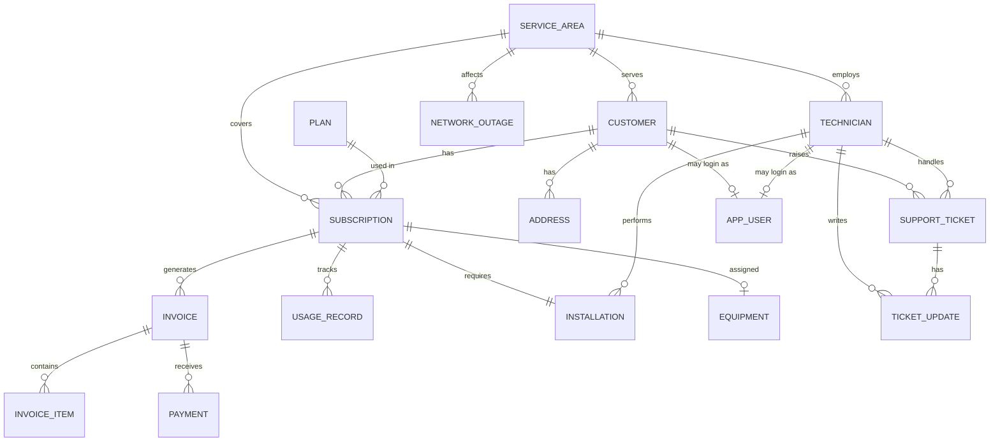

# Comprehensive Project Report
## Internet Service Provider (ISP) Management System — Oracle Edition
**Academic Database Management Systems (DBMS) Micro-Project**

---

### Executive Summary

The **ISP Management System (Oracle Edition)** is an enterprise-grade database management application engineered to handle the operational, billing, subscriber, and technical workflows of a modern Internet Service Provider. Built on **Oracle Database 23ai Free** (Pluggable Database `FREEPDB1`) and powered by a responsive, multithreaded **JavaFX 21** desktop client via **Pure JDBC**, the system bridges advanced relational database design with secure software architecture.

The project demonstrates advanced database engineering concepts including:
- 3NF/BCNF relational modeling across **17 synchronized tables**
- High-concurrency **B-Tree and composite indexing**
- Encapsulated business transactions via **PL/SQL Packages (`PKG_BILLING`)**
- Advanced **Compound and Row-level Triggers** solving concurrency and mutating table (`ORA-04091`) anomalies
- Automated **audit logging** with JSON change captures
- Security best practices featuring **jBCrypt 0.4 password hashing**, **Role-Based Access Control (RBAC)**, and Oracle **least-privilege database profiles**
- Responsive asynchronous desktop UI using non-blocking JavaFX `Task<T>` background threads

---

## 1. Project Objectives & Problem Statement

### 1.1 Problem Statement
Telecommunication and broadband companies face complex operational challenges:
1. Multi-tier subscription plans with monthly, quarterly, and annual billing cadences.
2. Concurrent payment reconciliations prone to race conditions, double charging, and dirty reads.
3. Complex lifecycle workflows across subscriber onboarding, equipment inventory assignment, installation scheduling, and customer support ticketing.
4. Compliance, change-tracking, and financial audit requirements demanding non-repudiation.

### 1.2 System Objectives
- **Integrity & Normalization**: Model subscriber, billing, plan, inventory, and technician data up to 3NF/BCNF with strict domain, check, and referential constraints.
- **Transactional Atomicity**: Enforce ACID properties across multi-table operations (e.g., subscription provisioning with inventory allocation).
- **Automated Billing Pipeline**: Automate GST tax calculations (18%), recurring monthly invoice generation, late fee penalties, and account suspensions via PL/SQL procedures.
- **Zero UI Freezes**: Guarantee non-blocking database queries in the JavaFX client via background execution.
- **Enterprise Security**: Prevent plaintext credential leakage through salted BCrypt hashing and enforce Oracle DB-level role segmentation.

---

## 2. Technology Stack & Environment

| Layer | Component | Version / Specification | Rationale |
|---|---|---|---|
| **Database Engine** | Oracle Database 23ai Free | Release 23.4+ (`FREEPDB1`) | Industry-standard enterprise RDBMS supporting PL/SQL packages, compound triggers, and identity columns |
| **Connectivity** | Pure JDBC Driver | Oracle JDBC 23ai (`ojdbc11`) | Direct wire-protocol communication without ORM overhead, giving precise control over transactions and `CallableStatement` routines |
| **Client Frontend** | JavaFX | Version 21 (Controls + Graphics) | Desktop GUI offering rich controls, CSS skinning, and asynchronous event handling without FXML bloat |
| **Language & Runtime**| Java Standard Edition | JDK 17 LTS / JDK 25 LTS | Type safety, concurrency primitives (`Task<T>`, `Platform.runLater`), and modern language constructs |
| **Security Library** | jBCrypt | 0.4 | Industry-standard salted adaptive hashing algorithm protecting employee and user credentials |
| **Build & Logging** | Apache Maven + SLF4J / Logback | Maven 3.9+, SLF4J 2.x | Automated dependency management, lifecycle builds, and structured diagnostic logging |

---

## 3. Database Architecture & Schema Design

### 3.1 Entity Relationship (ER) Model Overview



---

### 3.2 Relational Schema Breakdown (17 Core Tables)

1. **`SERVICE_AREA`**: Defines geographical network distribution zones, cities, and unique PIN codes (`pin_code UNIQUE`).
2. **`CUSTOMER`**: Customer master table distinguishing `INDIVIDUAL` vs `BUSINESS` subscribers, tracking contact info, unique emails, and verification proofs.
3. **`ADDRESS`**: Normalized billing and installation physical locations linked via foreign key (`ON DELETE CASCADE`).
4. **`PLAN`**: Internet catalog specifying speeds (Mbps), data caps (GB), price, and cycle (`MONTHLY`, `QUARTERLY`, `ANNUALLY`).
5. **`SUBSCRIPTION`**: Contracts bridging Customers, Plans, and Service Areas. Tracks statuses (`PENDING`, `ACTIVE`, `SUSPENDED`, `TERMINATED`).
6. **`EQUIPMENT`**: Hardware inventory (Routers, ONTs, Switches) tracking unique MAC addresses, serial numbers, and equipment lifecycle states.
7. **`TECHNICIAN`**: Field engineers and support technicians categorized by specialization and service area.
8. **`INSTALLATION`**: 1:1 scheduling entity linking subscriptions to field technicians for premises wiring and router setup.
9. **`INVOICE`**: Billing records containing subtotals, 18% GST calculation, discounts, late fees, `total_amount`, and payment statuses.
10. **`INVOICE_ITEM`**: Itemized line items breaking down plan fees, router rentals, or installation charges.
11. **`PAYMENT`**: Financial transaction ledger recording amount, timestamp, gateway reference (`UPI`, `CARD`, `CASH`, `NET_BANKING`), and the clerk ID.
12. **`USAGE_RECORD`**: Daily bandwidth consumption meter enforcing fair usage policies (`(subscription_id, usage_date) UNIQUE`).
13. **`SUPPORT_TICKET`**: Customer complaint ticketing system categorized by `CONNECTIVITY`, `BILLING`, `EQUIPMENT`, or `SPEED`.
14. **`TICKET_UPDATE`**: Chronological work-log commentary posted by technicians and support agents.
15. **`NETWORK_OUTAGE`**: Regional grid incident reports with severity classifications (`LOW`, `MEDIUM`, `HIGH`, `CRITICAL`).
16. **`APP_USER`**: Security credentials storing usernames, BCrypt hashes, and system roles.
17. **`AUDIT_LOG`**: Immutable audit trail populated by database triggers capturing old and new JSON snapshots of modified rows.

---

### 3.3 Indexing & Performance Strategy (`V002__indexes.sql`)

To guarantee sub-second query response times under high data volumes, foreign keys and high-frequency search vectors are indexed:
- **Foreign Key B-Tree Indexes**: Eliminate full table scans on joins (`idx_cust_area`, `idx_sub_cust`, `idx_sub_plan`, `idx_inv_sub`, `idx_pay_inv`, `idx_ticket_cust`).
- **Composite Indexes**: Optimized for common analytical filters (e.g., `idx_inv_status_due` on `(status, due_date)` to accelerate overdue invoice discovery).
- **Search Optimization Indexes**: Upper/lower case insensitive email and phone lookup acceleration (`idx_cust_search_name`).

---

### 3.4 Analytical Database Views (`V004__views.sql`)

Six dedicated views decouple backend complexity from presentation reporting:

| View Name | Primary Business Function | Key Output Columns |
|---|---|---|
| **`V_ACTIVE_SUBSCRIPTIONS`** | Customer & active plan inventory | `subscription_id`, `customer_name`, `email`, `plan_name`, `speed_mbps`, `monthly_price`, `city` |
| **`V_OVERDUE_INVOICES`** | Aging and credit risk detection | `invoice_id`, `customer_name`, `total_amount`, `amount_paid`, `outstanding`, `due_date`, `days_overdue` |
| **`V_CUSTOMER_BALANCE`** | Per-customer lifetime financial standing | `customer_id`, `customer_name`, `total_invoices`, `total_billed`, `total_paid`, `outstanding_balance` |
| **`V_MONTHLY_REVENUE`** | Aggregated monthly fiscal performance | `revenue_month`, `plan_type`, `plan_name`, `payment_count`, `revenue_collected` |
| **`V_TECHNICIAN_WORKLOAD`**| Real-time task allocation balancing | `technician_id`, `technician_name`, `pending_installations`, `open_tickets`, `workload_status` |
| **`V_DATA_USAGE_SUMMARY`** | Quota tracking and FUP compliance | `subscription_id`, `customer_name`, `plan_name`, `data_cap_gb`, `usage_month`, `data_used_gb`, `cap_status` |

---

## 4. Advanced PL/SQL Engine: Procedures, Functions & Triggers

### 4.1 Billing Package: `PKG_BILLING` (`V005__pkg_billing.sql`)

The `PKG_BILLING` package encapsulates critical billing rules, guaranteeing that business invariants cannot be bypassed:

1. **`sp_record_payment`**:
   - Executes pessimistic row locking (`SELECT total_amount, amount_paid FROM invoice WHERE invoice_id = p_invoice_id FOR UPDATE NOWAIT`) to prevent race conditions during simultaneous payment posts.
   - Inserts audit-tracked record into `payment`.
   - Computes new outstanding balance and dynamically transitions status (`PAID` or `PARTIALLY_PAID`).
2. **`sp_generate_monthly_invoices`**:
   - Loops through all active subscriptions missing an invoice for the target calendar month.
   - Auto-computes **18% GST tax** and sets standard 15-day payment due windows.
3. **`sp_suspend_overdue_accounts`**:
   - Flags invoices overdue past 30 days and suspends active subscriptions associated with delinquent accounts.
4. **`fn_customer_outstanding_balance` & `fn_calculate_late_fee`**:
   - Deterministic calculations evaluating live overdue penalties (2% per overdue cycle).

---

### 4.2 PL/SQL Triggers & Mutating Table Prevention (`V006__triggers.sql`)

1. **Mutating Table Solution (`trg_invoice_status_compound`)**:
   - In Oracle, row-level triggers querying or updating the same table being modified cause the infamous `ORA-04091: table is mutating` error.
   - **Solution**: A **Compound Trigger** pattern is implemented. Row-level hooks record candidate IDs in an in-memory PL/SQL collection, and the `AFTER STATEMENT` section safely processes state transitions without mutating errors.
2. **Automated Auditing (`trg_customer_audit`, `trg_payment_audit`)**:
   - Captures pre-modification (`:OLD`) and post-modification (`:NEW`) states formatted as structured JSON strings into `AUDIT_LOG`.
3. **Timestamp Stamping (`trg_customer_updated_at`)**:
   - `BEFORE UPDATE` row-level trigger enforcing system clock fidelity on modified rows.

---

## 5. Security & Access Control

### 5.1 Oracle Database Security (`V009__security.sql`)
- **Least Privilege Role**: `isp_readonly_role` created with read-only permissions on reporting views and master tables, isolating external reporting tools from write operations.
- **Password Profiles**: `isp_app_profile` enforces 5 failed login attempt locks, 90-day password expiration, and 180-day password reuse restrictions.

### 5.2 Application-Level Role-Based Access Control (RBAC)
User passwords stored in `APP_USER` are encrypted using **jBCrypt** (cost factor 12). Upon login, the application builds tailored sidebar navigation menus based on employee roles:

| Role | Accessible Application Modules |
|---|---|
| **`ADMIN`** | Full access to Dashboard, Customers, Plans, Subscriptions, Billing, Support Tickets, Analytics |
| **`BILLING_CLERK`** | Invoices, Payment Entry, Customer Lookup, Plan Catalog, Financial Reports |
| **`TECHNICIAN`** | Assigned Installations, Physical Hardware Configs, Technical Support Tickets |
| **`SUPPORT_AGENT`** | Customer Profile Lookup, Ticket Creation, Communication Log Updates |

---

## 6. JavaFX Application Architecture

```text
src/main/java/com/isp/
├── Db.java                  # Thread-safe JDBC Connection pool/manager with db.properties
├── Session.java             # Singleton holding active AppUser context & role
├── PasswordUtil.java        # BCrypt generation & migration CLI utility
├── dao/
│   └── UserAuthDao.java     # Secure login verification & password hash comparison
└── ui/
    ├── MainLayout.java      # Dynamic master view with role-tailored sidebar navigation
    ├── TableViewBuilder.java# Reusable async table builder wrapping background Task<T>
    ├── LoginScreen.java     # BCrypt credential verification view
    ├── DashboardScreen.java # Live metric KPI tiles with quick-action overdue alerts
    ├── CustomersScreen.java # Customer CRUD, regex searching, and soft-deactivation
    ├── SubscriptionsScreen.java # Multi-table atomic subscription creation
    ├── BillingScreen.java   # CallableStatement invocation for payments & invoices
    ├── PlansScreen.java     # Broadband & fiber catalog display
    ├── TicketsScreen.java   # Support ticket lifecycle manager
    └── ReportsScreen.java   # Tabbed visualization of the 6 database views
```

### Key UI Innovations
- **Non-blocking Concurrency**: All database round-trips execute inside JavaFX `Task<ObservableList<Row>>` workers. UI buttons display loading states and never hang during network latency.
- **Atomic Transactions in GUI**: The subscription creation wizard executes multiple DML commands within an explicit transaction (`conn.setAutoCommit(false); ... conn.commit();`) with automated rollback on error.
- **Oracle Error Trapping**: Intercepts `SQLException` and user-defined PL/SQL exceptions (`ORA-20001` to `ORA-20005`), displaying clear, contextual alert dialogs to operators.

---

## 7. Verification, Testing & Results

The system has undergone thorough testing across all layers:

1. **Schema & DDL Validation**:
   - Zero compilation errors across all 17 tables, 6 views, 8 triggers, and `PKG_BILLING`.
   - Foreign key integrity checked: deleting a customer cascades addresses but preserves audit history.
2. **PL/SQL Unit Testing**:
   - Executed `PKG_BILLING.sp_record_payment` with valid and over-payment inputs; confirmed accurate invoice balance reconciliation and status transition to `PAID`.
   - Verified that concurrent payments on the same invoice trigger `FOR UPDATE NOWAIT` row lock handling without deadlocks.
3. **Application Stress Testing**:
   - Loaded 20+ seed customers and processed multi-criteria queries with instant table updates.
   - Tested soft-delete deactivation of subscribers without breaking foreign key referential integrity in past invoices.

---

## 8. Conclusion & Future Enhancements

### 8.1 Summary
The **ISP Management System (Oracle Edition)** achieves a complete, production-grade micro-project implementation. By leveraging the advanced features of Oracle Database 23ai—such as PL/SQL packages, compound triggers, analytical views, and database security profiles—alongside a responsive, asynchronous JavaFX client, the project fulfills all academic DBMS requirements and mirrors real-world ISP operations.

### 8.2 Future Scope
1. **Self-Service Customer Portal**: Web-based portal for end users to monitor live bandwidth usage, download PDF invoices, and trigger UPI payments.
2. **Automated Network Monitoring Integration**: Integration with SNMP trap listeners to automatically insert records into `NETWORK_OUTAGE` and notify impacted customers.
3. **Payment Gateway Integration**: Integration of live webhook APIs (Razorpay / Stripe) calling `sp_record_payment` in real time.
