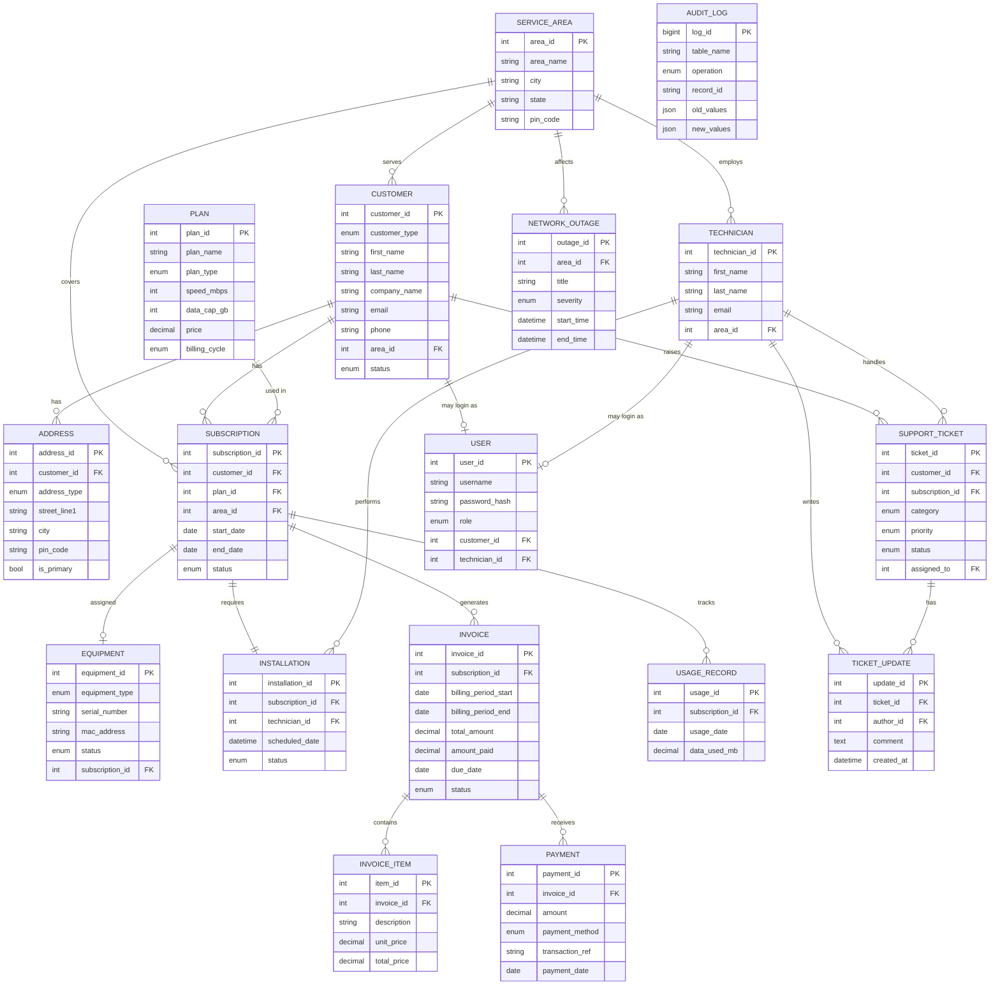

# ER Diagram — ISP Management System

## Mermaid Source (paste into https://mermaid.live)



## dbdiagram.io Source (paste into https://dbdiagram.io)

```
Table service_area { area_id int [pk, increment] area_name varchar city varchar state varchar pin_code varchar [unique] is_active bool }
Table customer { customer_id int [pk, increment] customer_type enum email varchar [unique] phone varchar area_id int [ref: > service_area.area_id] status enum }
Table plan { plan_id int [pk, increment] plan_name varchar [unique] plan_type enum speed_mbps int price decimal billing_cycle enum }
Table subscription { subscription_id int [pk, increment] customer_id int [ref: > customer.customer_id] plan_id int [ref: > plan.plan_id] area_id int [ref: > service_area.area_id] start_date date status enum }
Table invoice { invoice_id int [pk, increment] subscription_id int [ref: > subscription.subscription_id] total_amount decimal amount_paid decimal due_date date status enum }
Table payment { payment_id int [pk, increment] invoice_id int [ref: > invoice.invoice_id] amount decimal payment_method enum payment_date date }
Table equipment { equipment_id int [pk, increment] serial_number varchar [unique] mac_address varchar [unique] status enum subscription_id int [ref: > subscription.subscription_id] }
Table installation { installation_id int [pk, increment] subscription_id int [ref: - subscription.subscription_id] technician_id int [ref: > technician.technician_id] status enum }
Table technician { technician_id int [pk, increment] first_name varchar last_name varchar email varchar [unique] area_id int [ref: > service_area.area_id] }
Table support_ticket { ticket_id int [pk, increment] customer_id int [ref: > customer.customer_id] assigned_to int [ref: > technician.technician_id] priority enum status enum }
Table user { user_id int [pk, increment] username varchar [unique] password_hash varchar role enum customer_id int [ref: > customer.customer_id] }
```
